# Travel Explorer 🧭

A React Native (Expo) app for discovering destinations across India and saving favourites for future trips.
Built for the **GDGC VNRVJIET App Development volunteer recruitment assignment**.

> Author: Suryatej Bandla ([@surya-txj](https://github.com/surya-txj))

### What's new in v2
- **Firebase (Auth + Firestore):** real email/password sign-in with guest fallback. The Buddy Finder is a realtime shared feed, and the wishlist and trip planner sync per user (with an offline cache). Local data is migrated on first sign-in. Security rules are in `firestore.rules`.
- **ExchangeRate-API key:** uses the authenticated v6 endpoint, with backup sources and a small "Using backup rates" note when needed.
- **Cinematic redesign of Destinations, Details, My Trips, Buddies and Packages:**
  - full-bleed hero slides with giant condensed titles that sit *behind* the scenery
  - vertical wipes between destinations and a "See details" expand
  - sliding card carousels, a swipeable trip stack with progress rings
  - an expanding "Post a trip" button and a step-by-step matcher with animated rankings
- The Home page, splash screen, top navigation and Home hero transition are unchanged.

See [CHANGELOG.md](CHANGELOG.md) for every file that changed.

---

## Screenshots

| Home | Details | Wishlist | Trip Matcher |
|------|---------|----------|--------------|
| 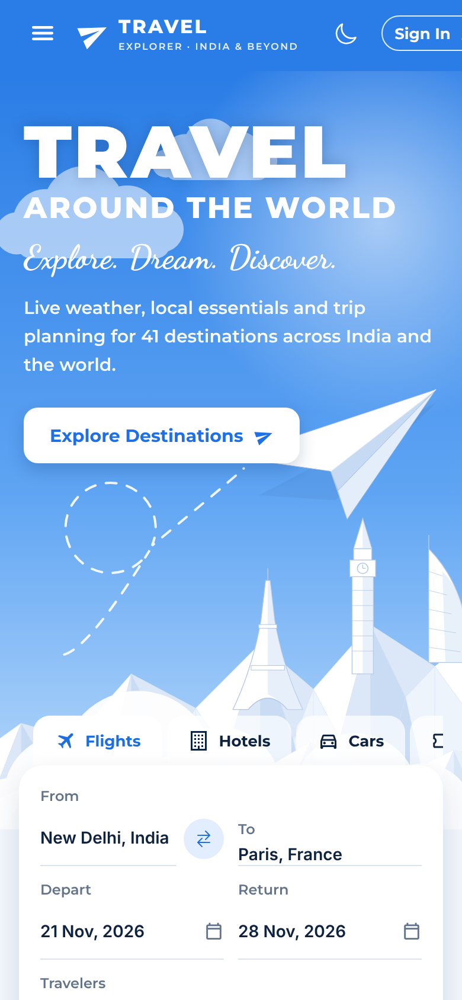 | 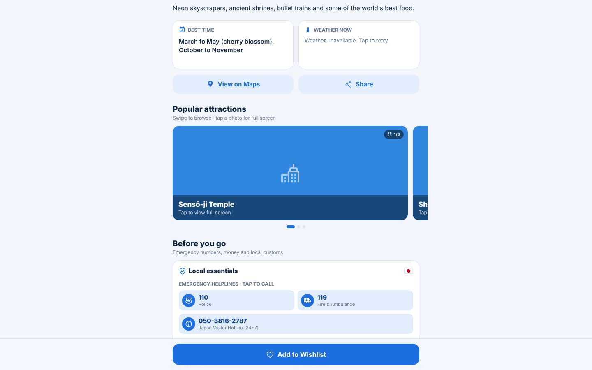 | 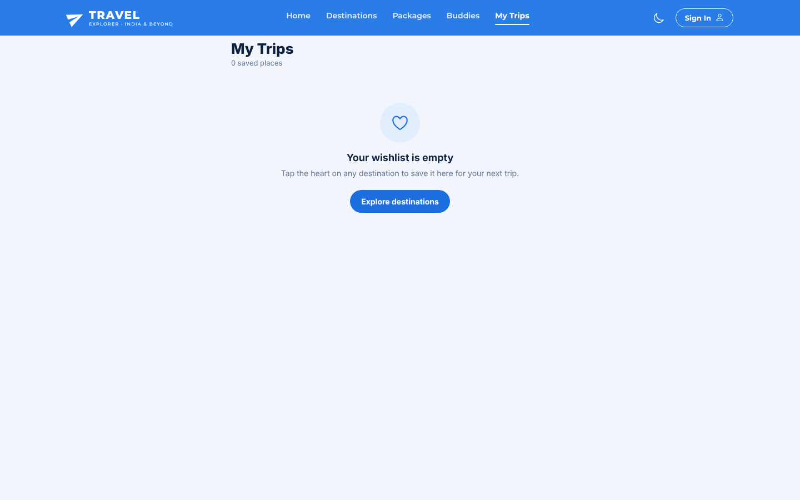 | 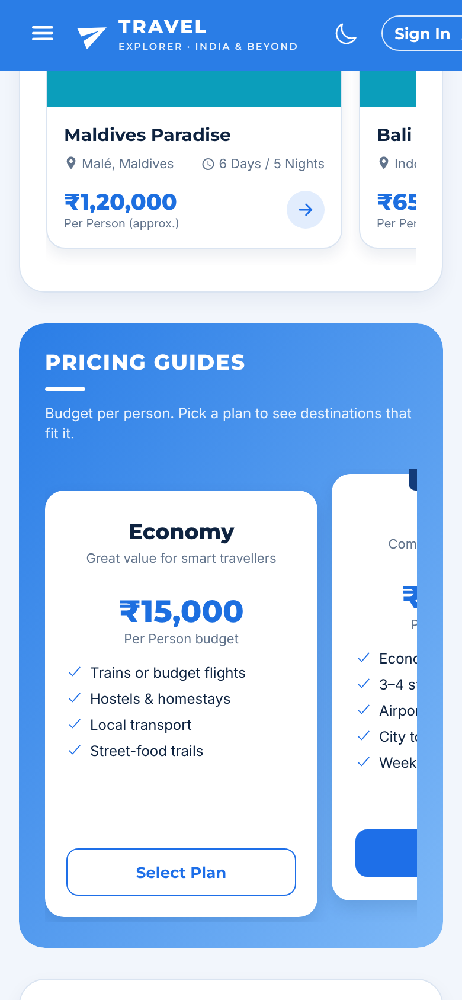 |

| Dark mode | Attraction gallery | Full-screen viewer |
|-----------|--------------------|--------------------|
| 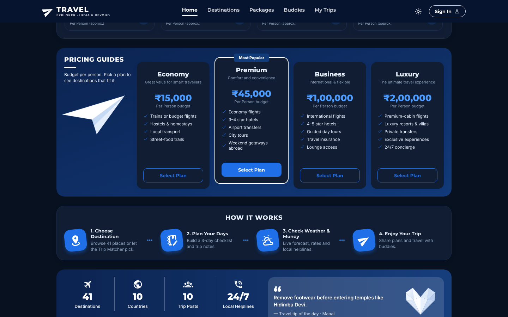 | 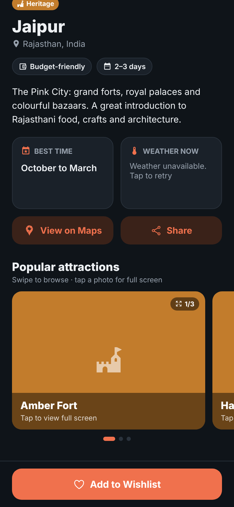 | 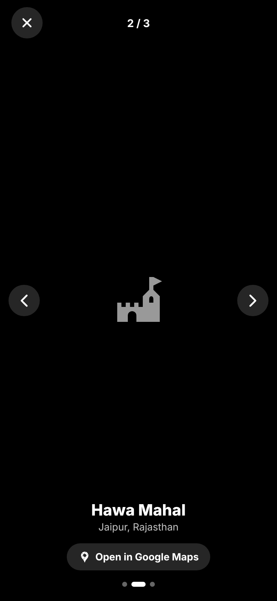 |

| Local essentials | Currency converter | Travel buddies |
|------------------|--------------------|----------------|
| 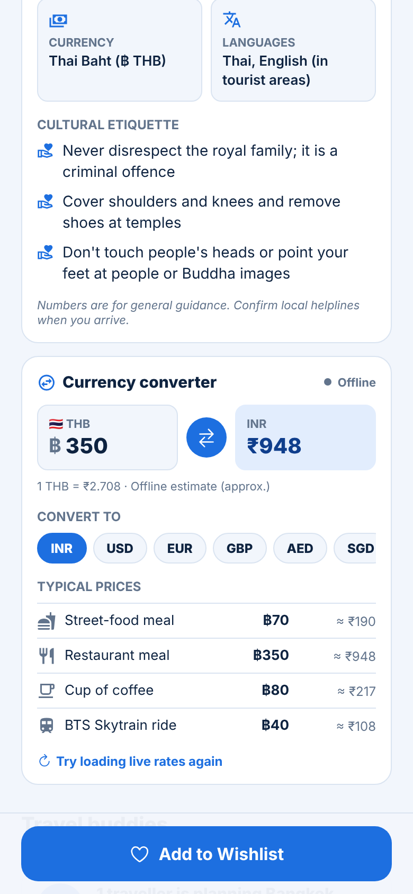 | 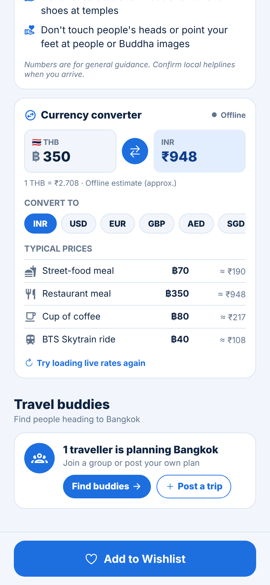 | 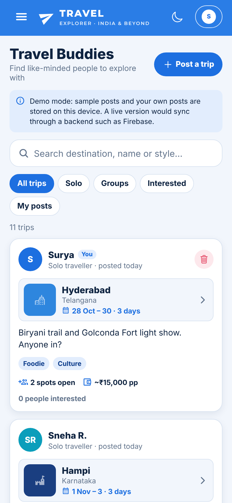 |

**Desktop layout** (template-style landing page with top navigation):

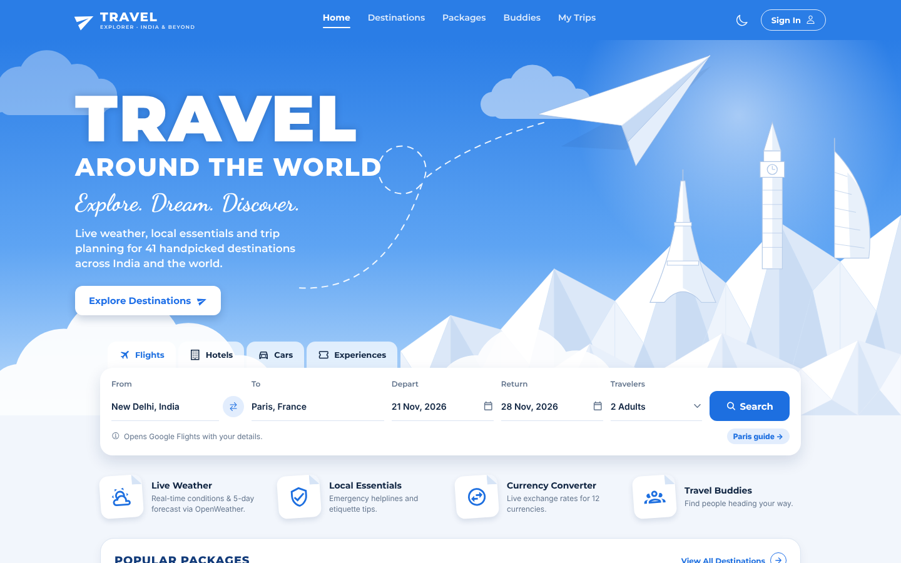

| Splash screen | Trip planner | Train budget slider | Hero transition |
|---------------|--------------|---------------------|-----------------|
| 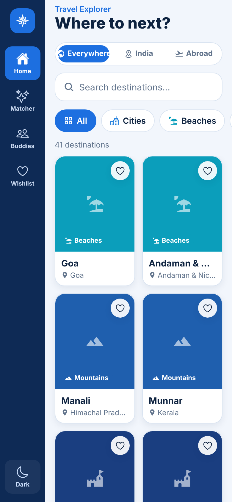 | 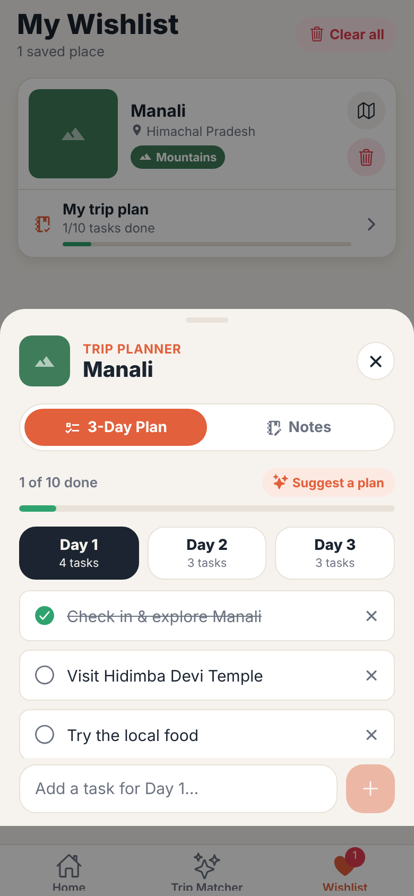 | 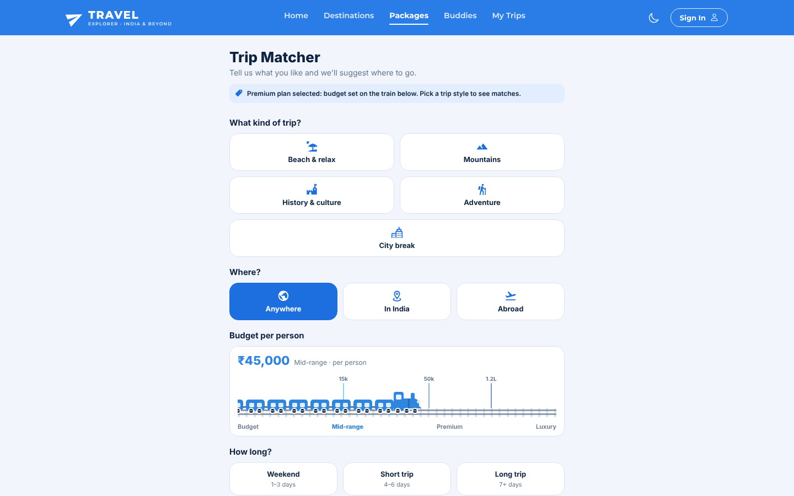 | 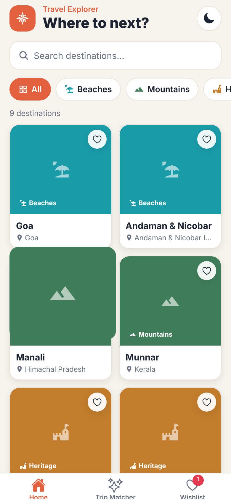 |

---

## Features

### Core requirements

| Stage | What's implemented |
|-------|--------------------|
| **1. Destination Discovery** | 41 destinations: 32 across India (every major city plus beaches, hills, heritage and adventure spots) and 9 abroad (Dubai, Singapore, Bangkok, Bali, Maldives, Paris, London, New York, Tokyo). They're grouped into 5 categories (Cities, Beaches, Mountains, Heritage, Adventure). Each card shows a photo, name, location (with a flag for places abroad) and a category badge. |
| **2. Navigation & Details** | A website-style top navigation bar (Home, Destinations, Packages, Buddies, My Trips). On phones it becomes a menu that slides in from the left. A Details screen opens from any page. Details show a description, the best time to visit and 3 popular attractions with photos. |
| **3. Search & Filtering** | Live search by name (or state) combined with category chips. Both work together: for example, "Mountains" plus "man" shows only Manali. Includes a result count and an empty state with a "Clear filters" button. |
| **4. Travel Wishlist** | Add or remove from the heart on any card, from the Details screen button, or from the Wishlist screen. Every screen updates instantly, and the tab bar shows a live count badge. |

### Extension challenges (all 4 done)

| Extension | How it works |
|-----------|--------------|
| **Smart Destination Matcher** | Choose a trip style, budget and duration. Each destination gets a 0–100% score with reasons ("Fits your budget", "In season (Oct)"). |
| **Live Weather** | Real-time data from the [OpenWeather API](https://openweathermap.org/api): current temperature, conditions, feels-like, humidity, wind, sunrise/sunset and a 5-day forecast on every Details page, plus live temperature badges on the Home package cards. If no key is configured (or a new key isn't active yet), it automatically falls back to [Open-Meteo](https://open-meteo.com/). |
| **Google Maps** | "View on Google Maps" on Details, a map button on each Wishlist item, and tapping any attraction opens it in Google Maps. |
| **Local Storage + cloud sync** | The wishlist and trip plans are cached with AsyncStorage, so they survive restarts and work offline. With Firebase configured they also sync to Firestore for each signed-in user. |

### Additional features

| Feature | How it works |
|---------|--------------|
| **Attraction photo gallery** | On the Details screen, attractions appear in a swipeable carousel. Cards snap into place, the next card peeks in from the side, and page dots track your position. Tapping a photo opens a full-screen viewer where you can swipe through high-resolution photos (with arrow buttons for web/tablets), see a counter, and jump to Google Maps. |
| **Dark mode** | Follows the phone's system light/dark setting by default. The sun/moon button on Home switches it manually, and that choice is saved. Every screen, the tab bar, the navigation theme and the status bar all switch together. |
| **Emergency & local info** | Every destination has a "Local essentials" card. It lists emergency helplines you can tap to call (for example 112 / 100 / 108 / 1091 and the 24×7 tourist helpline in India, 911 in New York, 191 / 1669 / 1155 Tourist Police in Thailand), the local currency, the languages spoken and three cultural etiquette tips. |
| **Currency converter** | A real-time converter on the Details page. Type an amount in the local currency (or swap direction) and pick your home currency, which is remembered. It also converts typical prices such as a street meal, coffee or a metro ride. Rates come from the ExchangeRate-API v6 endpoint using your key. If the key is missing or invalid, the app uses the keyless ExchangeRate-API endpoint, then the European Central Bank (Frankfurter), then saved or estimated rates, and shows a small "Using backup rates" note. Rates are cached for 6 hours. |
| **Travel Buddy Finder** | A Buddies section where solo travellers and groups post trip plans: destination, dates, trip length, group size, buddies wanted, travel style and budget. Others can browse, search, filter (Solo / Groups / Interested / My posts) and tap "I'm in!". Each Details page shows how many people are planning that destination, with "Find buddies" and "Post a trip" buttons. **With Firebase**, posts live in Firestore and update live for every user, "I'm in!" adds your uid to a post, and only a post's owner can edit or delete it. **Without Firebase**, or while the database is empty or unreachable, sample posts from fictional travellers are shown and your own posts stay on the device. |
| **Template landing page** | The Home page follows the "Travel Around The World" design: a sky hero with a floating paper plane, a dashed flight trail and paper mountains with the Eiffel Tower, Big Ben and a sail hotel. Below it come a search card (Flights / Hotels / Cars / Experiences), feature tiles, popular packages, pricing guides, how it works, a stats band and a footer. Template placeholders such as fake ratings, testimonials and "10K+ travellers" are replaced with real app data: live temperatures, an "in season" badge, actual destination and country counts, and a daily travel tip. |
| **Search card** | Flights opens Google Flights, Hotels opens Google Hotels and Cars opens a car-rental search, each pre-filled with your cities, dates (chosen in a built-in calendar) and number of travellers. Experiences opens the matching destination guide in the app. |
| **Pricing guides** | Economy / Premium / Business / Luxury budgets per person. "Select Plan" opens the Trip Matcher with the train slider already set to that budget. |
| **Sign in (Firebase Auth)** | The Sign In button opens real email/password sign-in: create an account, sign in, reset your password or sign out. If you're not signed in, the app uses an anonymous *guest* account so syncing still works. Creating an account from a guest session upgrades it in place and keeps your data. Without Firebase keys, it falls back to the original on-device traveller name. |
| **Cinematic tabs (v2)** | **Destinations:** a hero view with full-bleed photos and giant condensed titles where the landscape overlaps the lettering. Swipe or scroll for a vertical wipe to the next place while the background tint changes. "See details" shrinks the title to the top-left, dims the photo, fades in the description and slides in overlapping attraction cards. The grid view is still one tap away. **Details** uses the same stage, and the Home hero flight lands on it. **My Trips** is a stack of hero cards: swipe up or down to browse, swipe sideways to remove (with a spring), see a planner progress ring, and plan in a draggable bottom sheet. **Buddies** has staggered cards, an animated "I'm in!", sliding filter pills and a floating button that expands into the form. **Packages** is a 5-step flow with a filling stepper, score rings and results that glide into their new order. Tabs share a fade-and-slide transition, and everything respects the OS "Reduce motion" setting. |
| **Blue theme + dark mode** | Shades of blue throughout, with a full dark theme (night-sky hero included). |
| **Animated splash screen** | A 3D globe spins in on startup against deep space: twinkling stars, shooting stars, a nebula glow and sonar-style ripple rings. A cloud layer drifts over the continents, gold pins pop up on every destination in the app, and glowing flight paths arc from India to cities abroad. An airplane with a contrail and a small satellite orbit on differently tilted paths, passing behind and in front of the globe. The title appears letter by letter above a loading bar. Once the saved data has loaded, the splash zooms and fades into the already-rendered Home screen. |
| **Trip planner** | Every wishlist card has a "Plan trip" bar. It opens a bottom sheet with a 3-day checklist (add, tick and delete tasks, or tap "Suggest a plan" to auto-fill one from the destination's attractions) and free-text notes that autosave as you type. Progress shows on the wishlist card, and everything is saved on the device. |
| **Hero transitions** | Tapping a card on Home or the Wishlist makes its photo fly and grow into the Details header, while the content slides up. Going back with the back button flies the photo back into its card. There are also micro-animations: staggered card fade-ins, press-to-shrink springs, a heart "pop", and smooth add/remove in lists. |
| **Train budget slider** | In the Trip Matcher, you set your budget by dragging a train along a railway track (or tapping the track). Carriages couple on behind the engine instead of a filled line, the wheels spin and steam puffs while it moves, and it changes colour across the Budget, Mid-range and Premium zones. Destinations are scored against their approximate cost per person. |
| **Share destination** | The share icon on the Details hero (and the Share button) opens the native Android/iOS share sheet with the destination's name, description, best time to visit, top attractions and a Google Maps link. On the web it uses the browser's share dialog or copies the text to the clipboard. |

### Extra polish
- Destination and attraction photos are loaded from Wikipedia in one batched API request, and the URLs are cached. If a photo can't load, a coloured placeholder with the category icon is shown instead, so the UI never looks broken.
- Each category has its own colour and icon, used consistently across the app.
- Tapping a selected Trip Matcher option again unselects it.
- Every list has an empty state.

---

## Tech stack

- **React Native** with **Expo** (JavaScript)
- **React Navigation**: native stack + tab navigator rendered as a top navigation bar
- **ExchangeRate-API / Frankfurter** for live currency rates
- **React Context API** for global wishlist and image state
- **AsyncStorage** for persistence
- **@expo/vector-icons** (Ionicons and MaterialCommunityIcons)
- **OpenWeather API** for real-time weather & forecasts (Open-Meteo as fallback)
- **react-native-svg** for the illustrations, splash globe and train slider
- **Montserrat + Dancing Script** fonts via `@expo-google-fonts`
- **Wikipedia MediaWiki API** for photos

---

## Getting started

### Prerequisites
- Node.js 20 or newer
- The **Expo Go** app on your phone ([Android](https://play.google.com/store/apps/details?id=host.exp.exponent) / [iOS](https://apps.apple.com/app/expo-go/id982107779))

### Add your OpenWeather API key

1. Create a free account at [openweathermap.org](https://openweathermap.org/) and copy your key from **API keys**.
2. In the project folder, copy the example env file and paste your key:

```bash
cp .env.example .env
```

```
EXPO_PUBLIC_OPENWEATHER_API_KEY=your_real_key_here
```

3. Restart Expo with `npx expo start -c` so the key is picked up.

> New OpenWeather keys can take up to a couple of hours to activate. Until then, the app shows weather from Open-Meteo and notes that under the forecast. The `.env` file is git-ignored, so your key isn't committed.

### Add your ExchangeRate-API key (currency converter)

1. Sign up for the free plan at [exchangerate-api.com](https://www.exchangerate-api.com/). Your API key is shown on the dashboard straight away.
2. Paste it into `.env`:

```
EXPO_PUBLIC_EXCHANGERATE_API_KEY=your_real_key_here
```

3. Restart Expo and clear its cache so the new value is bundled:

```bash
npx expo start -c
```

> Without a key (or with an invalid one) the converter still works with backup rates and shows a small "Using backup rates" note.

### Connect Firebase (sign-in + cloud sync), optional

Everything works without Firebase (local-only mode). To turn on accounts, the shared Buddy feed and cloud sync:

1. **Create a project.** Go to [console.firebase.google.com](https://console.firebase.google.com) → **Add project** → give it a name (e.g. `travel-explorer`). Google Analytics is optional.
2. **Register a web app.** On the project overview, click the **Web** icon (`</>`), give it a nickname and click **Register app** (Hosting isn't needed). Firebase shows a `firebaseConfig` object; keep that page open.
3. **Enable Authentication.** Go to **Build → Authentication → Get started → Sign-in method** and enable:
   - **Email/Password**
   - **Anonymous** (used for guest mode; if you leave it off, users who aren't signed in stay in local-only mode)
4. **Create Firestore.** Go to **Build → Firestore Database → Create database**, pick a location close to your users (e.g. `asia-south1`, Mumbai), and start in **production mode**.
5. **Publish the security rules.** In Firestore, open the **Rules** tab, replace everything with the contents of [`firestore.rules`](firestore.rules) from this project, and click **Publish**. Users can only read and write their own `users/{uid}` data; Buddy posts can be read by everyone but changed only by their owner (anyone signed in can add or remove only their *own* "I'm in!").
6. **Paste the keys.** Copy the values from `firebaseConfig` (also under **Project settings → General → Your apps**) into `.env`:

```
EXPO_PUBLIC_FIREBASE_API_KEY=AIza...
EXPO_PUBLIC_FIREBASE_AUTH_DOMAIN=your-project.firebaseapp.com
EXPO_PUBLIC_FIREBASE_PROJECT_ID=your-project
EXPO_PUBLIC_FIREBASE_STORAGE_BUCKET=your-project.firebasestorage.app
EXPO_PUBLIC_FIREBASE_MESSAGING_SENDER_ID=1234567890
EXPO_PUBLIC_FIREBASE_APP_ID=1:1234567890:web:abc123
```

7. **Restart Expo** with `npx expo start -c`, open the app and tap **Sign In** → **Create account**. Your existing wishlist and trip plans are copied into the account the first time you sign in on that device.

**Troubleshooting**
- *"Sync blocked – check Firestore rules"*: the rules in step 5 weren't published.
- *"Guest mode unavailable"*: enable the **Anonymous** provider (step 3).
- *"This sign-in method is not enabled"*: enable **Email/Password** (step 3).
- The Firebase web API key isn't a secret password (security comes from the rules), but keep `.env` out of git anyway. It's already in `.gitignore`.

### Run it

```bash
git clone https://github.com/surya-txj/travel-explorer.git
cd travel-explorer
npm install
npx expo start
```

Then scan the QR code with Expo Go on Android, or with the Camera app on iOS. Your phone and computer must be on the same Wi-Fi network. If they aren't, run `npx expo start --tunnel`.

To run in a browser, use `npx expo start --web`.

---

## Project structure

```
travel-explorer/
├── App.js                      # Root: wraps the app in providers + navigator
├── src/
│   ├── data/destinations.js    # Static destination data + search/filter function
│   ├── navigation/AppNavigator.js  # Stack (Tabs + Details); tabs shown as a top nav bar
│   ├── navigation/TopNav.js    # Top navigation bar + mobile drawer
│   ├── home/                   # Landing page: HeroBanner, SearchWidget, Sections, Illustrations
│   ├── services/weather.js     # OpenWeather (current + 5-day) with Open-Meteo fallback
│   ├── data/countries.js       # Emergency numbers, currency, typical prices per country
│   ├── screens/BuddyScreen.js  # Travel Buddy Finder feed (realtime with Firebase)
│   ├── stage/                  # v2 cinematic "stage": HeroSlide (depth title), HeroDeck (vertical wipe),
│   │                           #   StageDetails (shrink title + reveal), CardCarousel, stageStyles (tints/horizons)
│   ├── motion/                 # shared easing, FadeSlideIn, ProgressRing, reduce-motion support
│   ├── services/firebase.js    # Firebase app/auth/firestore setup from EXPO_PUBLIC_FIREBASE_*
│   ├── services/cloudSync.js   # per-user Firestore docs, offline cache keys, first-sign-in migration
│   ├── hooks/useSyncedState.js # AsyncStorage cache + realtime Firestore sync hook
│   ├── context/AuthContext.js  # email/password + guest auth
│   ├── screens/
│   │   ├── HomeScreen.js       # Landing page (template design)
│   │   ├── DestinationsScreen.js # Grid, search bar, region + category filters
│   │   ├── DetailsScreen.js    # Hero image, info, weather, maps, attractions
│   │   ├── WishlistScreen.js   # Saved destinations, remove / clear all
│   │   └── MatcherScreen.js    # Smart Destination Matcher
│   ├── components/             # Reusable UI (cards, chips, search bar, etc.)
│   │   ├── AttractionGallery.js  # Swipeable attraction carousel
│   │   ├── GalleryViewer.js    # Full-screen photo viewer (Modal)
│   │   ├── ThemeToggle.js      # Sun/moon dark mode button
│   │   ├── TripPlannerSheet.js # Notes + 3-day checklist bottom sheet
│   │   └── TrainBudgetSlider.js  # Railway budget slider
│   ├── splash/
│   │   ├── SplashScreen.js     # Space scene, globe, pins, flight arcs, orbits
│   │   └── worldShapes.js      # Simplified continent outlines
│   ├── hero/
│   │   ├── HeroContext.js      # Measures cards, starts hero flights
│   │   └── HeroOverlay.js      # Draws the flying image
│   ├── context/
│   │   ├── ThemeContext.js     # Light/dark palettes, system + manual mode
│   │   ├── WishlistContext.js  # Wishlist state + AsyncStorage persistence
│   │   ├── TripPlanContext.js  # Trip notes & checklists + persistence
│   │   └── ImageContext.js     # Loads & caches photo URLs
│   ├── hooks/useWeather.js     # Fetches live weather
│   ├── services/wikiImages.js  # Batched Wikipedia photo lookup
│   ├── utils/matcher.js        # Matcher scoring logic
│   ├── utils/maps.js           # Opens Google Maps
│   ├── utils/share.js          # Native share sheet
│   └── theme.js                # Colours, radii, category colours/icons
```

---

## How it works

**Navigation.** A native stack holds two screens: `Tabs` and `Details`. `Tabs` is shown as a website-style top bar, using `tabBarPosition: 'top'` and a custom `tabBar` component (`TopNav.js`). Because Details sits *above* the tabs, any page can open it with `navigation.navigate('Details', { id })`. Pages pass data to each other through route params; for example, a pricing plan sends `{ budget, plan }` to the Trip Matcher.

**Search and filter.** `HomeScreen` keeps `query` and `category` in `useState`. `filterDestinations()` keeps a destination only if it matches the category (or "All") **and** its name or state contains the search text. The function is wrapped in `useMemo` so it only re-runs when one of those values changes.

**Wishlist.** `WishlistContext` stores an array of destination ids. Any component can call `toggle(id)`, `remove(id)` or `isWishlisted(id)` through the `useWishlist()` hook. When the array changes, React re-renders every screen that uses it, which is why the heart, the button, the list and the badge all stay in sync. Two `useEffect`s handle persistence: one loads the array from AsyncStorage on startup, and one saves it whenever it changes.

**Weather.** `services/weather.js` calls OpenWeather's `/data/2.5/weather` and `/data/2.5/forecast` endpoints with the destination's coordinates and your key from `process.env.EXPO_PUBLIC_OPENWEATHER_API_KEY`. The forecast arrives in 3-hour steps, so it's grouped into days using the city's timezone offset (min/max temperature, an early-afternoon icon and the highest rain chance). OpenWeather condition ids are mapped to icons. If the key is missing or rejected (401), or the request fails, the same data shape is built from Open-Meteo instead. Results are cached for 10 minutes and duplicate requests are shared, so the 8 package cards on Home cost at most 8 calls.

**Trip Matcher.** Each destination scores points for matching trip style (40), budget (25, or 10 if one level away), trip length (20) and being in season this month (15). If a trip style is selected, only places that suit it are shown. The rest are sorted by score.

**Dark mode.** `theme.js` defines a light and a dark colour palette with the same keys. `ThemeContext` reads the system setting with `useColorScheme()`, lets the user override it, and saves the choice to AsyncStorage. Each component builds its styles with a `makeStyles(colors)` function, and the `useThemedStyles` hook rebuilds them (memoised) only when the theme changes.

**Gallery.** `AttractionGallery` is a horizontal `FlatList` using `snapToInterval`, so each swipe lands exactly on a card. The current index is worked out from the scroll offset (`offset / cardWidth`) to drive the dots. Tapping a card opens `GalleryViewer`, a `Modal` holding a full-width `pagingEnabled` `FlatList`. It starts at the tapped photo using `initialScrollIndex` together with `getItemLayout`.

**Share.** `shareDestination()` builds a text message and passes it to React Native's built-in `Share.share()`, which opens the platform's native share sheet.

**Splash globe.** Continents are stored as longitude/latitude points. On every animation frame (`requestAnimationFrame`) the centre longitude moves a little, and an orthographic projection converts each point to x/y on a circle, which is drawn with `react-native-svg`. Points on the far side are pushed onto the edge so they disappear. Radial gradients fake the lighting (highlight, darker rim, atmosphere glow). The airplane follows a tilted ellipse: when `sin(angle) < 0` it's on the far side, so it's drawn before the globe (behind it), smaller and faded.

**Hero transition.** React Navigation has no built-in shared-element transitions, so this is custom. When a card is tapped, `measureInWindow` gives its photo's position on screen. Details opens with a fade, and an overlay above the navigator animates a copy of the photo from that rectangle to the header's rectangle (position, size and corner radius), then fades away, revealing the identical real header.

**Train slider.** A `PanResponder` tracks the drag (`dx`) and converts the engine's x position into a rupee value in ₹1,000 steps. The carriages sit in a container whose width equals the distance travelled, with `overflow: hidden`, so they appear coupled to the engine. The wheel spin, steam puffs and bounce are looping `Animated` values that only run while dragging.

**Trip planner.** `TripPlanContext` stores `{ notes, days: [[tasks], [tasks], [tasks]] }` per destination in AsyncStorage. Notes are debounced, saving 0.5 s after typing stops instead of on every key. `LayoutAnimation` animates tasks being added, ticked and removed.

**Photos.** On startup, `ImageProvider` sends one request to the Wikipedia API with every article title. It follows redirects, maps each title to a thumbnail URL, and caches the result in AsyncStorage. `PlaceImage` always draws a coloured placeholder first and the photo on top, so a missing photo simply leaves the placeholder visible.

---

**Currency converter.** All rates are stored as "units per 1 USD", so converting A→B is `amount / rate[A] * rate[B]`. `useExchangeRates` fetches once, shares the result through a module-level cache and saves it to AsyncStorage. If both APIs fail it falls back to saved or estimated rates and labels them "Offline".

**Buddy Finder.** `BuddyContext` merges your own posts (saved in AsyncStorage) with sample posts whose dates are generated relative to today, so the feed always shows upcoming trips. Swapping `addPost`, `deletePost` and `toggleInterest` for Firestore calls would make it multi-user.

**Splash flight paths.** Each route is a great-circle path between two lon/lat points, calculated with spherical interpolation (slerp). Points are lifted above the surface in the middle of the arc and revealed progressively, so each line appears to "fly" from India to its destination.

**Cloud sync (v2).** `useSyncedState(name)` powers the wishlist and the trip plans. It loads the device cache first (so it works offline), then listens to `users/{uid}/data/{name}` with `onSnapshot`. Local edits go to the cache straight away and to Firestore, which queues writes while offline. On conflicts the newer `updatedAt` wins. On first sign-in, `migrateIfNeeded` merges the pre-account local data, and any previous guest data, into the account. The Buddy feed is a realtime query on `buddyPosts`, ordered by `createdAt`. "I'm in!" uses `arrayUnion`/`arrayRemove` on `interested`, which the security rules restrict to the user's own uid.

**Depth titles (v2).** A real cut-out needs a mask per photo, so the stage uses a lighter trick. The giant title is drawn over the photo, then the part of the *same photo* below a per-destination "horizon" line (`stageStyles.js`) is drawn again on top, with a feathered edge made of thin strips of rising opacity. On landscape photos the hills or sea appear to sit in front of the letters. When "See details" expands, that foreground fades away as the title moves to the top-left.

## Possible improvements
- Per-photo segmentation masks for a pixel-perfect depth effect
- Chat between travellers who tapped "I'm in!"
- Bundle local images so photos work fully offline
- Add more destinations and a "Nearby" sort using the device location
- Add a multi-day weather forecast on the Details screen
